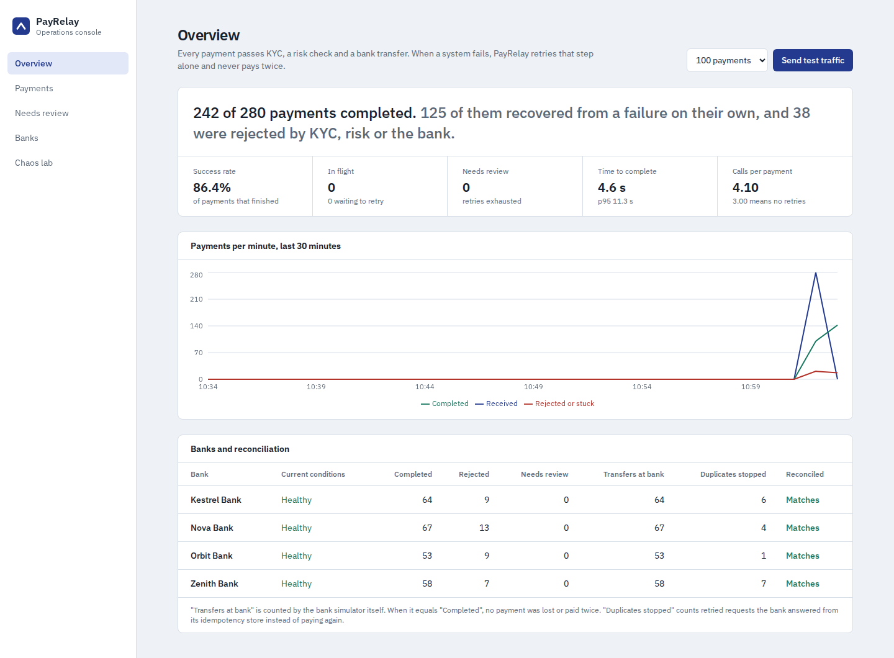
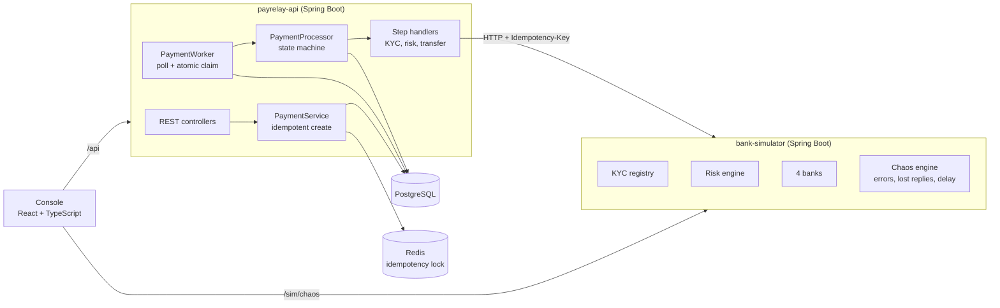
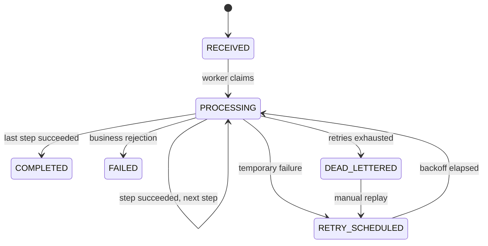
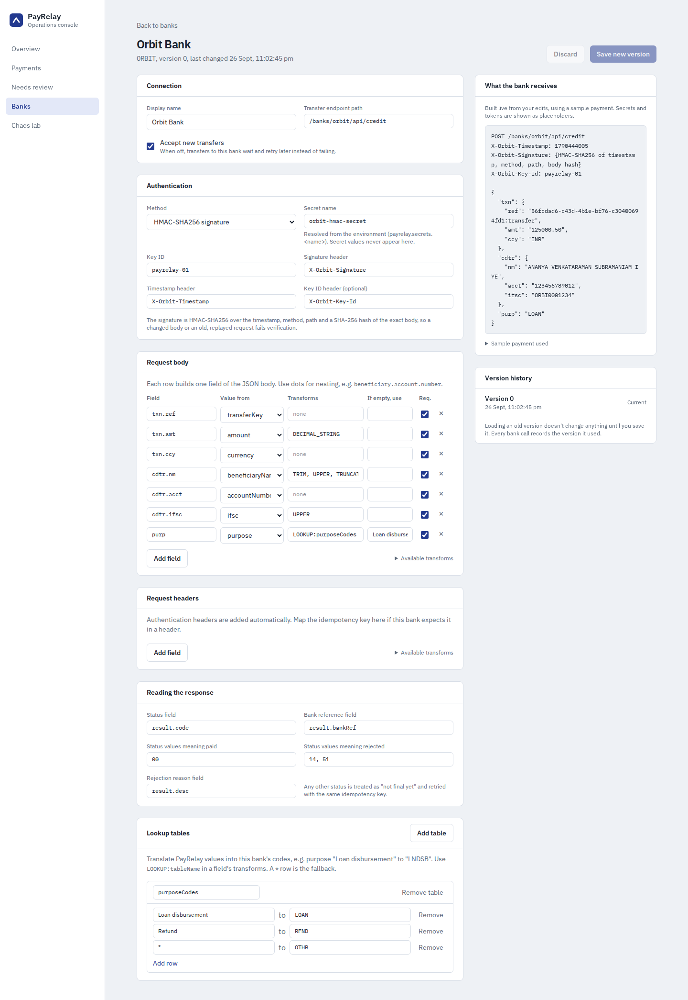
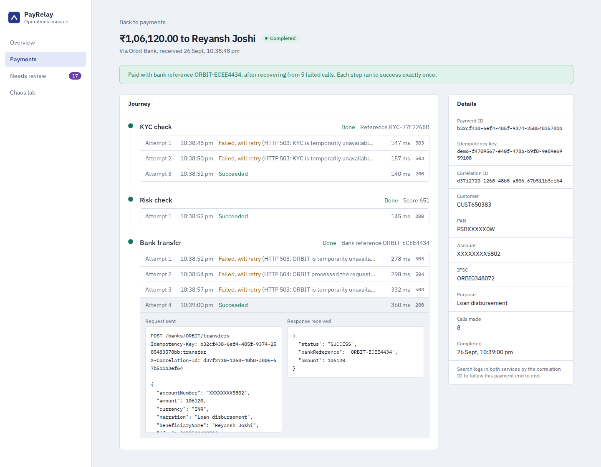
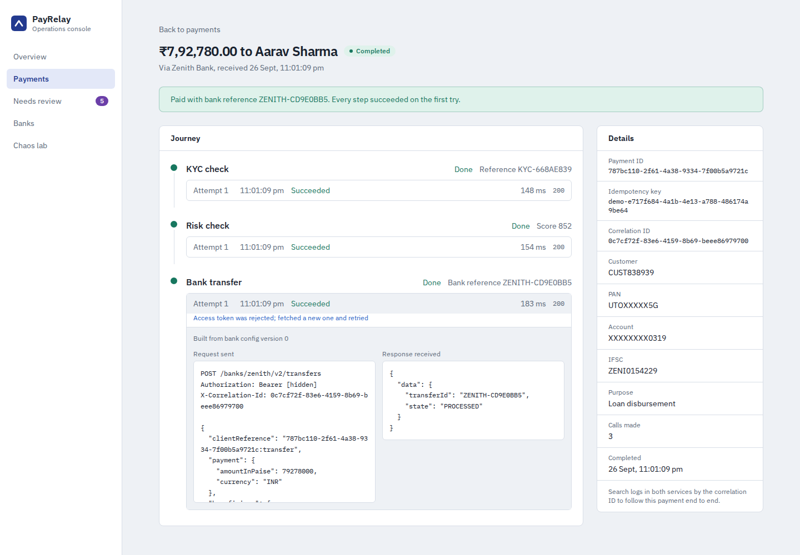
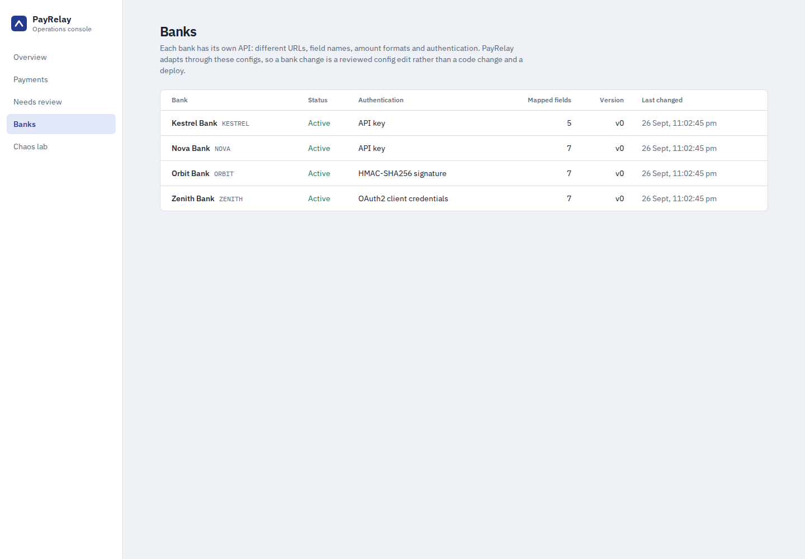
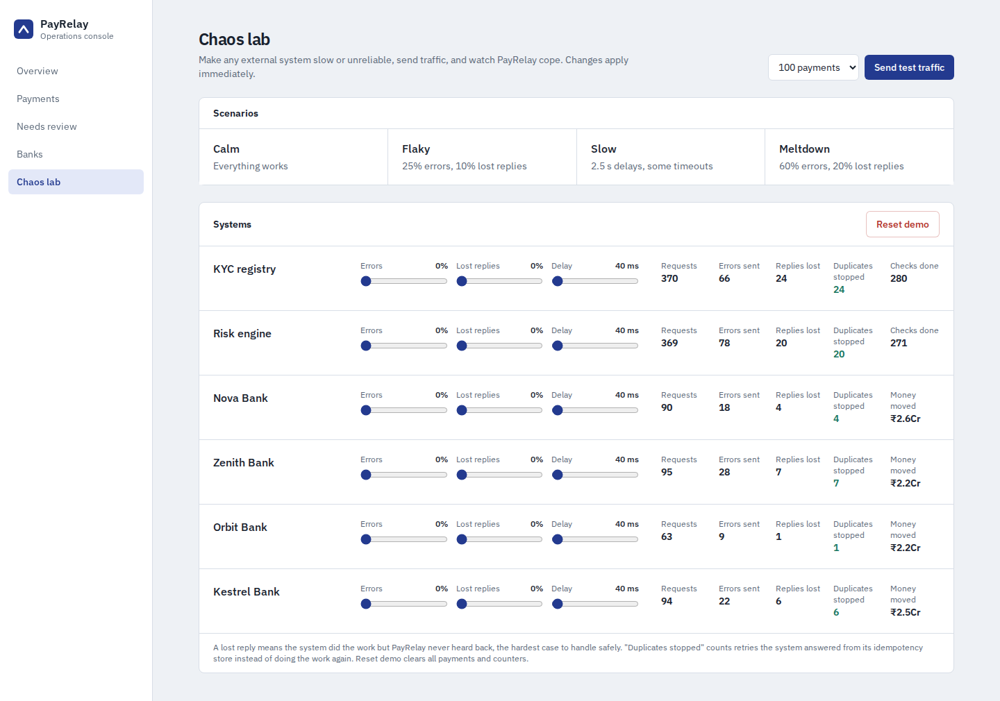

# PayRelay

**A fault-tolerant payment orchestration engine.** PayRelay sends loan disbursements through KYC, a risk check and a bank transfer, across external systems that time out, fail and lose responses, and it guarantees that every payment is completed **exactly once**.



## The problem

Paying out money means calling systems you don't control. A bank API times out: did the transfer happen or not? Retry blindly and you might pay twice. Don't retry and the customer never gets paid. Multiply that by several partners, each failing in its own way, and "just call the API" becomes the hardest part of the system.

PayRelay handles it with a small set of well-understood techniques, and ships with a simulator that attacks it on purpose so you can watch it cope.

## What it does

- **Idempotent API.** Every request carries an `Idempotency-Key`. A retried request returns the original payment; the same key with a different body is rejected with 422.
- **Step-level state machine.** Each payment records the step it's on. A retry resumes at the failed step and never re-runs a step that already succeeded.
- **Exactly-once transfers to the bank.** Every attempt at a step sends the same idempotency key downstream, so when a response is lost, the retry returns the bank's original result instead of paying again.
- **Retry classification.** Timeouts, 5xx, 408 and 429 are retried with exponential backoff and jitter. Business rejections (KYC failed, invalid account) stop immediately.
- **Dead-letter queue with replay.** Payments whose retries run out wait for a person. Replaying resumes at the step that failed.
- **Safe concurrency.** Workers claim payments with one conditional `UPDATE` plus a lease, so several instances can run and each payment is processed by exactly one of them. A crashed worker's payments are picked up when the lease expires.
- **Full audit trail.** Every call to an external system is stored with its request, response, status and duration, with identifiers masked.
- **Correlation IDs** across both services, in every log line and every outgoing call.
- **Config-driven bank integrations.** Four banks, four API dialects (different URLs, field names, amount formats, idempotency key locations and error formats), handled by versioned mapping configs instead of one adapter class per bank.
- **Three authentication schemes:** API keys, OAuth2 client credentials (cached tokens, refreshed transparently on 401) and HMAC-SHA256 request signing with replay protection. Secrets are referenced by name and never stored.
- **Operations console** (React) with live dashboards, a per-payment journey view, a dead-letter queue, a bank config editor with live request preview, and a chaos lab.

## Architecture



### Payment lifecycle



## How the guarantees work

**Creating a payment exactly once.** `PaymentService.create` checks three layers in order:

1. Is there already a payment with this key? Return it (or 422 if the body differs, compared by SHA-256 fingerprint).
2. Take a Redis `SET NX` lock on the key, so two identical requests arriving together can't both insert. The loser gets 409.
3. The `UNIQUE` constraint on `idempotency_key` is the final safety net if the lock were ever bypassed.

**Never repeating a completed step.** The payment row stores `current_step`. The processor only ever runs that step, and advances it after a success is committed. There is no code path that runs an earlier step again.

**Surviving lost responses.** The worst failure is when the bank moves the money but the reply never arrives. PayRelay can't know what happened, so it retries with the same key (`{paymentId}:transfer`). The bank recognises the key and returns the original reference. The simulator counts both sides, and the console's reconciliation table shows transfers at the bank next to completed payments.

**Configuration errors don't burn retries.** A mapping that fails or credentials a bank refuses go straight to review (not five pointless retries). Fix the config, replay, and the payment resumes at the bank step.

**No long transactions.** HTTP calls happen outside database transactions. State changes commit in short transactions before and after each call, so a slow bank never holds a DB connection.

## Bank integrations

Every bank speaks a different API. PayRelay stores each bank's endpoint, authentication, field mapping and response rules as a versioned JSON spec in `bank_configs`, and one generic transfer step executes whichever spec applies.

| Bank | Authentication | Payload style | Idempotency key sent as | Rejection reported as |
|---|---|---|---|---|
| Nova | `X-Nova-Key` header | flat snake_case, rupees | `Idempotency-Key` header | HTTP 422 |
| Zenith | OAuth2 client credentials | nested camelCase, paise, purpose codes | `clientReference` field | HTTP 200 with `state: REJECTED` |
| Orbit | HMAC-SHA256 signature | terse ISO-style, amount as text, 35-char names | `txn.ref` field | HTTP 200 with result code `14` |
| Kestrel | `Authorization: ApiKey …` | flat camelCase, paise | `X-Request-Id` header | HTTP 422 |

**Mapping rules.** Each output field takes a payment field (or a fixed value) through transforms such as `TRIM`, `UPPER`, `PAISE`, `DECIMAL_STRING`, `TRUNCATE:35` and `LOOKUP:purposeCodes`. Lookup tables translate PayRelay values into the bank's codes, with `*` as the fallback. Response rules say where the status, reference and rejection reason live, and which status values mean paid or rejected. Anything unrecognised is treated as "not final yet" and retried with the same key.

**Validation before saving.** A spec is checked for unknown fields, bad transforms, missing lookup tables, nesting conflicts and unset secrets. It is also refused if no field sends the transfer's idempotency key, because a retry after a lost response could then pay twice.

**Versioning.** Saving creates a new version (history kept; stale edits get 409 rather than silently overwriting), new transfers use it immediately, and every bank call records the version that built it.

**Authentication details.**
- *OAuth2:* tokens are cached until 30 seconds before expiry; only one thread fetches a token per bank while others wait; when a bank rejects a token early, exactly that token is dropped, a new one is fetched and the call is retried inside the same attempt.
- *HMAC:* the signature covers `timestamp`, method, path and the SHA-256 of the exact body bytes, so a modified body fails, and the bank rejects timestamps older than 5 minutes, so a captured request can't be replayed.
- *Secrets:* specs hold a `secretRef`; values come from `payrelay.secrets.*` (environment variables). Secrets, tokens, PANs and account numbers are masked in every stored request and response.



## Run it

### With Docker (full stack: Postgres, Redis, both services, console)

```bash
docker compose up --build
```

Open **http://localhost:3000**.

### Without Docker (in-memory database, good for development)

Needs Java 21 and Node 20+.

```bash
# terminal 1
cd bank-simulator && ./mvnw spring-boot:run

# terminal 2  (the "dev" profile uses H2 and an in-memory lock instead of Postgres and Redis)
cd payrelay-api && ./mvnw spring-boot:run -Dspring-boot.run.profiles=dev

# terminal 3
cd payrelay-ui && npm install && npm run dev
```

Open **http://localhost:5173**. On Windows use `mvnw.cmd`.

## Try the demo

1. On **Overview**, click **Send test traffic**. Payments complete within a second or two.
2. Open **Chaos lab** and choose **Flaky** (25% errors, 10% lost replies on every system). Send 300 payments.
3. Back on **Overview**, watch the numbers settle. Most payments recover on their own, and **Transfers at bank** still matches **Completed** for every bank.
4. Open any payment with several calls to see its journey: each failed attempt, the retry, and the raw request and response.
5. Drag one bank's errors to 90% and send more traffic. Payments pile up in **Needs review**. Set the bank back to calm and click **Replay all**.
6. Open **Banks**, pick a bank and edit its mapping. The preview on the right shows the exact request the bank will receive. Try removing the `transferKey` row to see the validator refuse it.
7. On **Zenith Bank**, click **Simulate token expiry**, then send traffic. Open a Zenith payment: its transfer succeeded on attempt 1 with a note that the token was refreshed.

**Magic values** for triggering rejections on purpose:

| System | Rule |
|---|---|
| KYC | A PAN starting with `ZZZ` is rejected |
| Risk | Score is derived from the customer ID; low scores are declined |
| Bank | An account number ending in `0000` is invalid; the IFSC prefix must match the bank |

## API

| Method | Path | Description |
|---|---|---|
| `POST` | `/api/payments` | Create a payment. Requires `Idempotency-Key`. Returns 202, or 200 with `Idempotent-Replayed: true` on replay |
| `GET` | `/api/payments/{id}` | Payment with its full attempt history |
| `GET` | `/api/payments?status=&bankCode=&page=&size=` | Search payments |
| `POST` | `/api/payments/{id}/replay` | Replay a dead-lettered payment |
| `GET` | `/api/stats` | Dashboard aggregates |
| `GET` | `/api/banks` | Bank configs |
| `GET` / `PUT` | `/api/banks/{code}` | Read or save a bank config (send the version you loaded) |
| `POST` | `/api/banks/{code}/preview` | Render the request an unsaved spec would send |
| `GET` | `/api/banks/{code}/history` | Every saved version |
| `POST` | `/api/demo/load` | Generate test traffic |

Example:

```bash
curl -X POST localhost:8080/api/payments \
  -H 'Content-Type: application/json' \
  -H 'Idempotency-Key: order-1001' \
  -d '{"customerId":"CUST42","customerPan":"ABCDE1234F","amount":25000,"currency":"INR",
       "beneficiaryName":"Aarav Sharma","accountNumber":"123456789012",
       "ifsc":"NOVA0001234","bankCode":"NOVA"}'
```

Errors use RFC 7807 `application/problem+json` and include the correlation ID.

## Tests

```bash
cd payrelay-api && ./mvnw test      # 49 tests
cd bank-simulator && ./mvnw test    # 15 tests
```

The orchestration tests run against a real database with scripted external systems and cover: resuming from the failed step, the same idempotency key on every transfer attempt, rejections not being retried, dead-letter and replay, 16 concurrent duplicate requests producing one payment, and only one worker winning a claim. Bank tests cover each dialect end to end, OAuth token refresh on 401, HMAC signatures (including a tampered body and an old timestamp being refused), a broken mapping going to review and replaying after the fix, a paused bank, and config versioning with conflict detection.

## Project structure

```
payrelay/
├── payrelay-api/          Spring Boot: API, state machine, worker, idempotency
│   └── src/main/java/com/payrelay/api/
│       ├── domain/        Payment, StepAttempt, status and step enums
│       ├── service/       PaymentService, PaymentProcessor, BackoffPolicy, StatsService
│       ├── worker/        PaymentWorker (poll, claim, dispatch)
│       ├── bank/          Bank configs, validation, versioning
│       │   ├── mapping/   Mapping engine, transforms, lookups
│       │   └── auth/      API key, OAuth2 token cache, HMAC signing, secrets
│       ├── step/          One handler per step
│       ├── client/        HTTP client that classifies failures
│       ├── idempotency/   Redis and in-memory locks
│       └── web/           Controllers, DTOs, error handling, correlation IDs
├── bank-simulator/        Spring Boot: fake KYC, risk and four bank dialects, chaos engine
├── payrelay-ui/           React + TypeScript + Tailwind console
└── docker-compose.yml
```

## Tech stack

Java 21, Spring Boot 3.5, Spring Data JPA, PostgreSQL, Flyway, Redis, JUnit 5, Mockito, React 19, TypeScript, TanStack Query, Tailwind CSS, Recharts, Docker Compose.

## Roadmap

- [x] Idempotent payment API, step state machine, retries with backoff, dead-letter queue
- [x] Bank simulator with chaos controls; operations console
- [x] Config-driven payload mapping per bank, with API key, OAuth2 client credentials and HMAC authentication; config editor with live preview and version history
- [ ] Bank callbacks (webhooks) with signature verification, duplicate and out-of-order handling
- [ ] Circuit breakers per bank (Resilience4j), so a failing bank is paused instead of retried
- [ ] Kafka with the transactional outbox pattern for payment events
- [ ] Testcontainers integration tests against real Postgres, Redis and Kafka
- [ ] Prometheus metrics and a Grafana dashboard; k6 load test with published results
- [ ] Deployment on AWS

## Screenshots

| Payment journey | Token refreshed transparently |
|---|---|
|  |  |

| Banks | Chaos lab |
|---|---|
|  |  |
